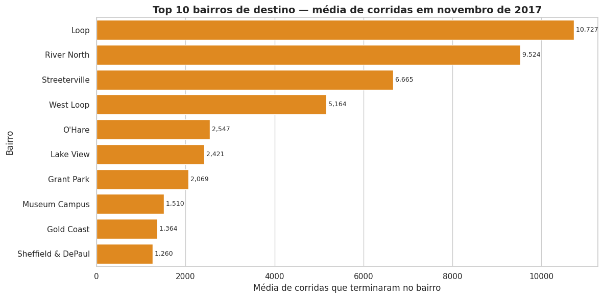
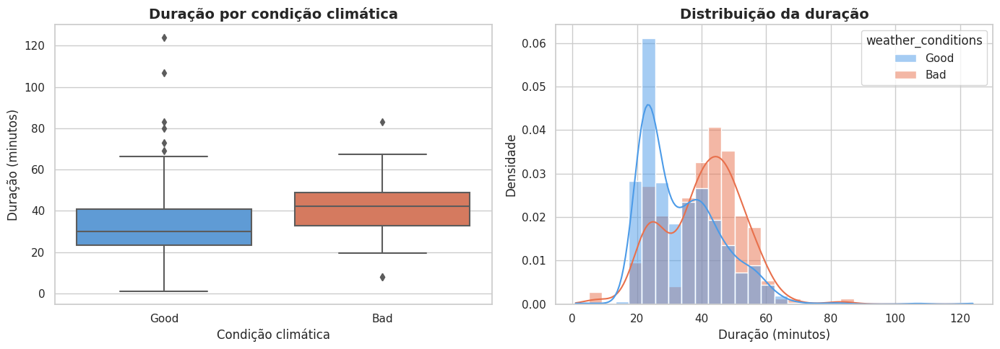

# Chicago Taxi Rides — Web Scraping, SQL & Hypothesis Testing (Zuber)

    

End-to-end analysis for **Zuber**, a ride-sharing company entering the Chicago market: who the competitors are,
where passengers go, and whether bad weather changes the duration of rides from the Loop to O'Hare airport.
Reviewer-approved project (TripleTen Data Scientist program, Sprint 7).

Projeto em três camadas: **coleta** (web scraping do clima de Chicago, nov/2017), **SQL** (seis consultas sobre
`cabs`, `trips`, `neighborhoods`, `weather_records`) e **análise em Python** (EDA + teste de hipótese).

| Top 10 destinos | Duração Loop → O'Hare por clima |
|---|---|
|  |  |

## Perguntas e respostas

| Pergunta | Resposta (nov/2017) |
|---|---|
| O mercado de táxi é concentrado? | Sim. **Flash Cab** tem **14,2%** das corridas; as **5 maiores somam 44,1%**. A empresa mediana fez só **178 corridas**, contra ~19,5 mil da líder. |
| Para onde os passageiros vão? | **Loop, River North, Streeterville e West Loop** lideram; os 10 principais bairros concentram **76,7%** dos destinos. O'Hare é o 5º. |
| Chuva muda a duração Loop → O'Hare aos sábados? | Sim. **40,5 min** com clima ruim vs. **33,5 min** com clima bom: **+7 min (+21%)**, teste t de Welch, **p = 2,4 × 10⁻¹¹**. A conclusão se mantém sem os valores atípicos (p = 3,9 × 10⁻¹⁴). |

## Etapas

1. **Coleta** — `requests` + `BeautifulSoup`: tabela horária de clima de Chicago (`weather_records`) extraída pelo `id` da tabela HTML.
2. **SQL** — registro das consultas: corridas por empresa (15–16/11), empresas Yellow/Blue, Flash Cab × Taxi Affiliation × Other, IDs de O'Hare e Loop, classificação Good/Bad por hora, corridas Loop → O'Hare aos sábados com `DATE_TRUNC` e `EXTRACT(DOW)`. As consultas completas estão em [`sql-data-analysis-postgresql`](https://github.com/artraxia/sql-data-analysis-postgresql/tree/main/06-projeto-zuber).
3. **EDA** — função `inspect()` reutilizável (tipos, nulos, duplicados), top 10 bairros, gráficos de empresas e destinos com conclusões apoiadas em números.
4. **Teste de hipótese** — limpeza de durações inválidas e duplicados; outliers por IQR com piso físico de 10 min; H₀/H₁ formuladas; **Levene** para escolher entre Student e **Welch**; teste de robustez sem outliers; interpretação com tamanho de efeito e limitações.
5. **Recomendações** — concentrar motoristas no centro e na rota do aeroporto; usar a previsão do tempo na estimativa de tempo de viagem; validar hipóteses com dados de tarifa, distância e horário.

## Estrutura

```
notebook/zuber_chicago_taxi.ipynb   # análise completa, com saídas e gráficos
docs/                               # gráficos exportados
data/                               # project_sql_result_01/04/07.csv (não versionados)
requirements.txt
```

## Como reproduzir

Os três CSVs são resultados das consultas SQL rodadas no banco da plataforma TripleTen e não estão no repositório.
Com eles em `data/`:

```bash
pip install -r requirements.txt
jupyter notebook notebook/zuber_chicago_taxi.ipynb   # Kernel → Restart & Run All
```

O passo de web scraping acessa a página pública de clima e roda sem os CSVs.

## Stack

Python · pandas · NumPy · Matplotlib · seaborn · SciPy · requests · BeautifulSoup · PostgreSQL · Jupyter
